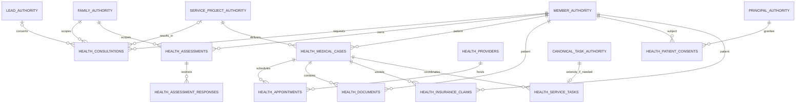

# Health logical model and field dictionary — candidate

Status: DESIGN ONLY / FK binding HOLD. This is not executable DDL. Names match
the Founder task logically; final physical names, types and migration number
must bind to the existing authorities. The current Canonical internal key rule
is application-issued UUIDv7. This package does not introduce a new ID rule.

## Logical ERD

`*_AUTHORITY` boxes are placeholders for required Canonical authorities, not
proposed new tables. Their physical existence and mapping must be verified;
Member, Lead, Service Project and Canonical Task remain unresolved.

## Dictionary and constraint intent

Types below are proposals except verified existing FK target types. `UUID FK`
never means permission to create a detached ID when the authority is missing.
Every table with `created_at`/`updated_at` uses TIMESTAMPTZ; creation time is
immutable and updates use server time.

| Object | Fields and purpose | Required integrity |
|---|---|---|
| `health_consultations` | `consultation_id` UUID PK; `family_id` family FK; `member_id` applicant FK; nullable `patient_member_id` patient FK; `service_type`; `source_channel`; `consultation_status`; nullable `lead_id`, `service_project_id`; timestamps | Types and FK targets must be verified; applicant and patient must belong to the active family; project/lead must match it. Only closed service/channel/status vocabularies from the task. No free-text symptoms, records or answers |
| `health_assessments` | `assessment_id` UUID PK; `member_id`, `family_id`; `questionnaire_version`; `assessment_status`; `result_category`; nullable `completed_at`; timestamps | Membership scoped to family; result is arrangement/navigation information, never diagnosis or medical risk; completion timestamp matches state; result vocabulary must come from approved version |
| `health_assessment_responses` | `response_id` UUID PK; `assessment_id` FK; `question_key`; `answer_payload` JSONB; timestamps | Unique `(assessment_id, question_key)`; approved closed answer vocabulary and payload bounds; no arbitrary JSON/free-text intake; no ordinary CRM/Founder/Timeline read |
| `health_medical_cases` | `case_id` UUID PK; `service_project_id`; `patient_member_id`; `case_type`; `case_status`; destination country/region; `opened_at`, nullable `closed_at`; timestamps | Required project FK; multiple patients/cases per project permitted with separate case-patient grants; case belongs to project family; no condition, diagnosis or treatment text |
| `health_providers` | `provider_id` UUID PK; `provider_name`; `provider_type`; country/region/city/address; `contact_channel`; `verification_status`, nullable `verified_at`; timestamps | Institution-only details; controlled type/status vocabulary; verification is evidence-based and not partnership/recommendation authority |
| `health_appointments` | `appointment_id` UUID PK; `case_id`, `provider_id` FKs; `appointment_type`; `appointment_status`; `scheduled_at` TIMESTAMPTZ; `timezone`; coordinator authority FK; timestamps | Valid IANA timezone; no duplicate source of UTC instant; coordinator uses existing member or staff authority only after its identity type is verified; restricted specialty/treatment details stored separately if approved |
| `health_documents` | `document_id` UUID PK; `case_id`, `patient_member_id`; `document_type`; `storage_object_key`; `encryption_key_reference`; `access_classification`; `uploaded_by_principal_id`; `uploaded_at`; nullable `deleted_at` | Patient matches case; opaque private key only, no public URL or encryption-key bytes; uploader is trusted principal; no file bytes; access requires fresh server decision |
| `health_patient_consents` | `consent_id` UUID PK; `patient_member_id`; `grantee_principal_id`; `consent_scope`; `consent_purpose`; `consent_status`; `granted_at`; nullable `expires_at`, `revoked_at`; `created_at` | Immutable grant identity; terminal revoke/expiry; validate current capacity and authority, grantor attribution and exact family/project/case/recipient binding before DDL finalization |
| `health_insurance_claims` | `claim_id` UUID PK; `case_id`, `patient_member_id`; insurer and claim reference; `claim_status`; `claimed_amount`, nullable `approved_amount` NUMERIC; `currency`; nullable `submitted_at`; `updated_at` | Nonnegative fixed-point amounts with defined precision/currency; patient matches case; attachments use Health documents; no service-fee/payment ledger |
| conditional `health_service_tasks` | `health_task_id` UUID PK; `canonical_task_id`; `case_id`; `task_category`; nullable `provider_id`; `created_at` | Only add if existing task model cannot express these links; preserve existing owner, due time, status and execution history; canonical task/project/patient scope must agree |

The exact enums in the Founder task remain the allowed candidate values. State
transitions need explicit mutation functions; a CHECK validates membership in
a vocabulary, not the legality of a transition.

## FK, indexes and authorization bindings

1. Reuse `core.families(family_id)` UUID. Keep existing `person_id` and ID mappings
   unchanged; do not rename it to `member_id` without the approved semantic map.
2. Add composite scope constraints where needed so a valid patient UUID cannot
   be attached to a different family, project, case or document. Validate changing
   memberships and assignments again at access time; an FK alone is insufficient.
3. Plan indexes on family/status/time consultation lists, assessment/response
   uniqueness, case project/patient/status, appointment case/time and provider/time,
   document case/patient/deletion, active consent subject/grantee/scope/expiry,
   claim case/status and canonical task/case links. Confirm actual query plans
   on synthetic data before keeping overlapping indexes.
4. The requested consent fields alone do not identify grantor authority, exact
   service-project/case scope or a named sharing recipient. Finalization must bind
   these to existing authorization records or approved Health-specific references.
   Patient ID plus a free-text purpose is not enough to satisfy the required
   cross-project isolation test. No invented authority columns are finalized here.
5. Institution resources may be non-patient data; an appointment linking a patient
   to an institution is still restricted. Treat claim metadata as patient-sensitive.
6. Versioned question/answer/result validation must preserve the approved
   fourteen questions, branching and results. A locally observed source string
   containing `draft` is not proof of Founder approval.
